<picture>
  <source media="(max-width: 600px)" srcset="./assets/hero-mobile.svg">
  
</picture>

  <a href="#the-workbench">The workbench</a> &nbsp; / &nbsp;
  <a href="#solar-roots">Solar roots</a> &nbsp; / &nbsp;
  <a href="#selected-builds">Selected builds</a> &nbsp; / &nbsp;
  <a href="https://github.com/MNik-EV?tab=repositories">All repositories ↗</a>

I build at the intersection of **embedded firmware, motor control, and power electronics**. My core focus: **STM32, FOC / BLDC motor drives, battery management systems, and DC UPS** — the electronics that turn code into something physical.

Previously, I led the **Electrical & Computer team for Persian Gazelle (غزال ایرانی)**, the Iranian solar car project. Electric mobility remains a thread through my work, from control firmware to energy systems.

## The workbench

| Control | Energy | Intelligence |
| :--- | :--- | :--- |
| **STM32 firmware** | **Battery management** | **Sensing & robotics** |
| FOC / BLDC motor drives | BMS & DC UPS | Sensor fusion & engineering tools |
| Timing, sensing, actuation | Monitoring, protection, power continuity | Connecting measurements to useful software |

**My engineering lens:** understand the hardware, make the firmware explicit, and let measurements guide the next iteration.

## Solar roots

**Persian Gazelle · غزال ایرانی** 
Former Electrical & Computer Team Lead

Solar and electric vehicles bring my interests together: **embedded control, motor drives, and energy management**. That connection is part of how I approach engineering, both at the bench and in code.

## Selected builds

<table>
<tr>
<td width="50%" valign="top">

### 01 / Motor control

**[STM32F446 · Single-shunt FOC ↗](https://github.com/MNik-EV/NUCLEOF446_SingleShunt_V05)**

Motor-control firmware on the NUCLEO-F446 platform, with single-shunt current sensing and the STM32 motor-control stack.

`C` `STM32F446` `FOC` `MCSDK`

</td>
<td width="50%" valign="top">

### 02 / Engineering tools

**[Engineering Copilot ↗](https://github.com/MNik-EV/engineering-copilot)**

Deterministic calculators and a source-aware assistant for electronics, embedded systems, power, and design review.

`Python` `PyQt6` `Power electronics`

</td>
</tr>
<tr>
<td width="50%" valign="top">

### 03 / Open hardware

**[Robot Shield · ATmega328P ↗](https://github.com/MNik-EV/Robot-Shield-ATmega328)**

A robot controller board combining power protection, battery monitoring, and practical hardware interfaces.

`PCB` `ATmega328P` `Robotics`

</td>
<td width="50%" valign="top">

### 04 / Perception

**[LiDAR–Camera Fusion ↗](https://github.com/MNik-EV/pedestrian-intent-edge)**

LD19 LiDAR and IMX219 camera fusion for object detection and metric ranging, with a Pi camera relay and laptop processing.

`Python` `Computer vision` `Sensor fusion`

</td>
</tr>
</table>

<b>More from the lab — libraries, learning tools & experiments</b>

 

| Project | What it explores |
| :--- | :--- |
| [ZLAB Ultrasonic Library](https://github.com/MNik-EV/ZLAB-Ultrasonic-Library) | C++ distance sensing with the HC-SR04 |
| [Interactive Embedded Roadmap](https://github.com/MNik-EV/interactive-embedded-roadmap) | A practical path through embedded systems engineering |
| [Ising Model](https://github.com/MNik-EV/IsingModel) | Monte Carlo simulation, numerical experiments, and a live web lab |

## Tools I work with

**Firmware & control** &nbsp; `C` `C++` `STM32` `STM32CubeIDE` `Motor Control SDK` 
**Hardware & energy** &nbsp; `FOC` `BLDC` `BMS` `DC UPS` `PCB` 
**Software & sensing** &nbsp; `Python` `OpenCV` `Git` `Raspberry Pi`

---

  <b>From a control loop to a moving machine.</b> 
  Interested in embedded systems, motor drives, or electric mobility? 
  Explore a project, open an issue, or start with the code.  
  <a href="https://github.com/MNik-EV?tab=repositories">Explore the lab ↗</a>

