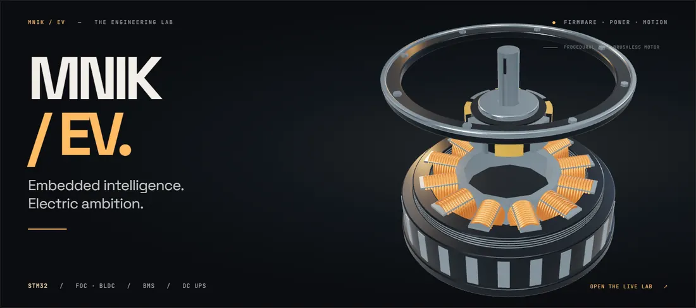
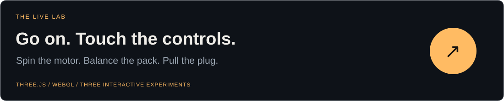
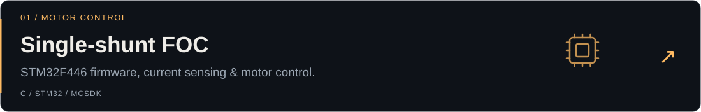
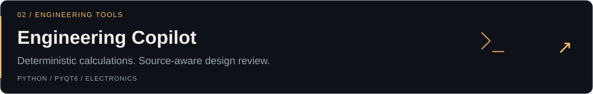
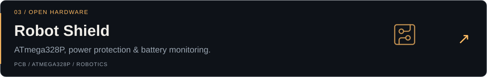
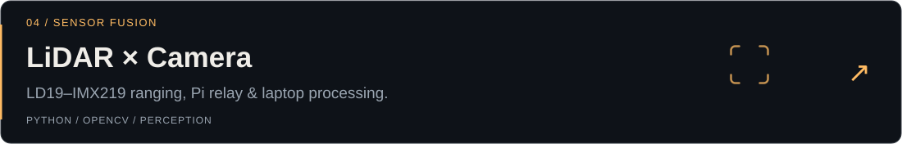
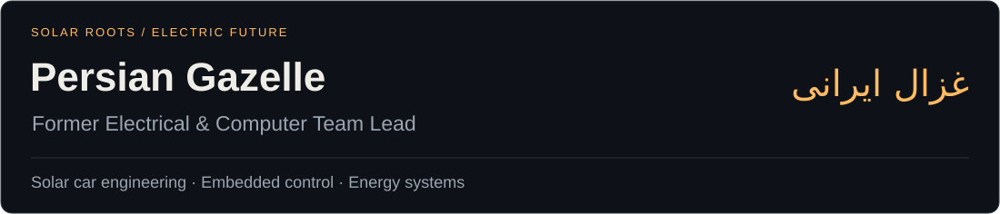

<a href="https://mnik-ev.github.io/MNik-EV/">
  <picture>
    <source media="(prefers-reduced-motion: reduce) and (max-width: 600px)" srcset="./assets/hero-mobile.webp">
    <source media="(prefers-reduced-motion: reduce)" srcset="./assets/hero.webp">
    <source media="(max-width: 600px)" srcset="./assets/hero-mobile-motion.webp">
    
  </picture>
</a>

<p align="center">
  <a href="https://mnik-ev.github.io/MNik-EV/"><b>▶ ENTER THE LIVE LAB</b></a> &nbsp; · &nbsp;
  <a href="#selected-builds">The builds</a> &nbsp; · &nbsp;
  <a href="#solar-roots">Solar roots</a> &nbsp; · &nbsp;
  <a href="#the-commit-eater">Feed the snake</a>
</p>

<picture>
  <source media="(max-width: 600px)" srcset="./assets/terminal-mobile.svg">
  
</picture>

I work where **firmware meets physics**: STM32, FOC / BLDC motor drives, BMS, and DC UPS. Previously, I led the **Electrical & Computer team of Persian Gazelle (غزال ایرانی)**. I care about what happens after the code leaves the editor.

<p align="center">
  
</p>

### A profile you can actually play with

<a href="https://mnik-ev.github.io/MNik-EV/">
  <picture>
    <source media="(max-width: 600px)" srcset="./assets/launch-mobile.svg">
    
  </picture>
</a>

**01 · Motor** — Orbit the 3D assembly, change speed and direction, explode the parts, or hit the emergency stop.<br>
**02 · Battery** — Introduce a weak cell and watch passive balancing reduce the spread.<br>
**03 · DC UPS** — Pull the input. Watch the battery keep the load running.

<sub>These are interactive, illustrative models. The lab runs on GitHub Pages; the cover above is captured from its actual Three.js scene.</sub>

### Selected builds

<a href="https://github.com/MNik-EV/NUCLEOF446_SingleShunt_V05">
  <picture>
    <source media="(max-width: 600px)" srcset="./assets/project-foc-mobile.svg">
    
  </picture>
</a>
<a href="https://github.com/MNik-EV/engineering-copilot">
  <picture>
    <source media="(max-width: 600px)" srcset="./assets/project-copilot-mobile.svg">
    
  </picture>
</a>
<a href="https://github.com/MNik-EV/Robot-Shield-ATmega328">
  <picture>
    <source media="(max-width: 600px)" srcset="./assets/project-shield-mobile.svg">
    
  </picture>
</a>
<a href="https://github.com/MNik-EV/pedestrian-intent-edge">
  <picture>
    <source media="(max-width: 600px)" srcset="./assets/project-fusion-mobile.svg">
    
  </picture>
</a>

<details>
<summary><b>Open the other drawer ↴</b></summary>

- [ZLAB Ultrasonic Library](https://github.com/MNik-EV/ZLAB-Ultrasonic-Library) — C++ distance sensing with the HC-SR04.
- [Interactive Embedded Roadmap](https://github.com/MNik-EV/interactive-embedded-roadmap) — a practical path through embedded engineering.
- [Ising Model](https://github.com/MNik-EV/IsingModel) — Monte Carlo experiments and a live web lab.
- [Browse everything ↗](https://github.com/MNik-EV?tab=repositories)

</details>

### Solar roots

<picture>
  <source media="(max-width: 600px)" srcset="./assets/gazelle-mobile.svg">
  
</picture>

Solar cars and electric vehicles bring my interests together: **control, power, and the software connecting them**.

### The commit eater

My contribution graph has a resident snake. It runs on commits.

<picture>
  <source media="(prefers-color-scheme: dark)" srcset="./assets/activity-dark.svg">
  
</picture>

<sub>Generated from my GitHub contribution calendar · <a href="./assets/activity-updated.json">snapshot timestamp</a> · powered by <a href="https://github.com/Platane/snk">Platane/snk</a>.</sub>

<details>
<summary><b>⚠ Do not press this button.</b></summary>

```cpp
// You pressed it. Of course you did.
while (coffee > 0) {
    measure();
    debug();
    try_again();
}
// The oscilloscope knows what you did.
```

[The real emergency stop is in the lab. ↗](https://mnik-ev.github.io/MNik-EV/)

</details>

<p align="center">
  <br>
  <b>Keep the current flowing. Keep the magic smoke inside.</b><br><br>
  <a href="https://mnik-ev.github.io/MNik-EV/">Play with the lab</a> &nbsp; / &nbsp;
  <a href="https://github.com/MNik-EV?tab=repositories">Explore the code</a>
</p>
